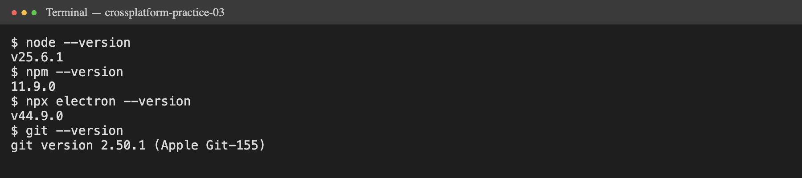
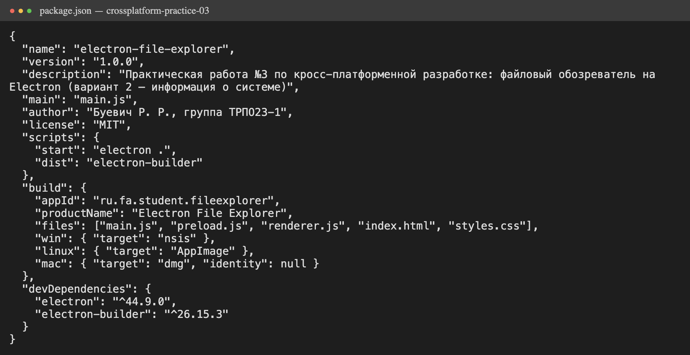
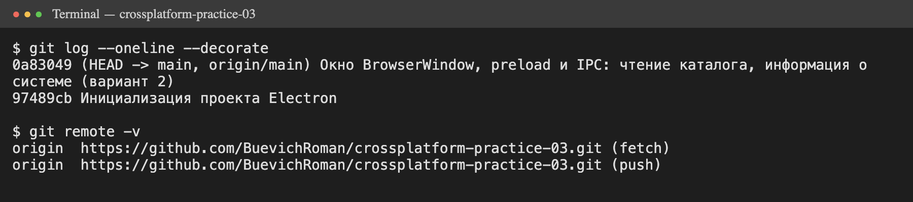
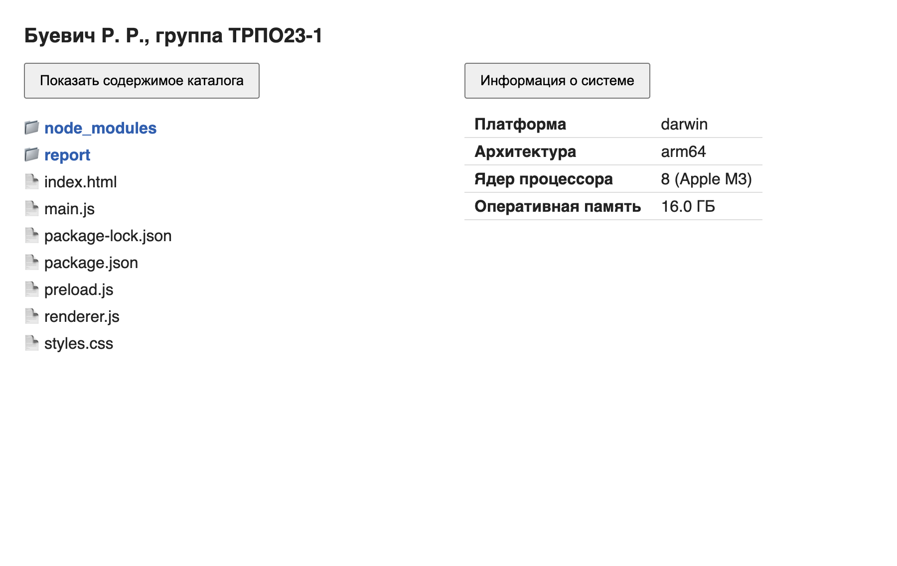
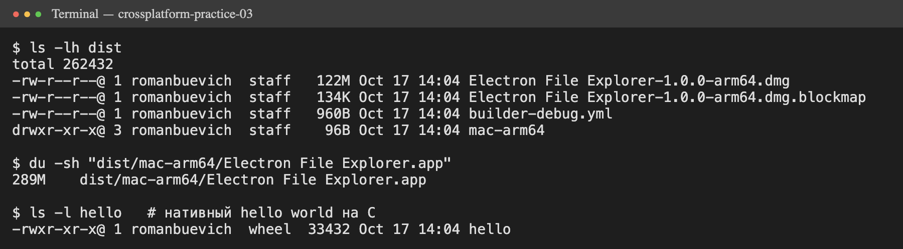

|   |   |
|---|---|
| Дисциплина | Кросс-платформенная разработка |
| Тема 2 | Кросс-платформенная разработка десктопных программ |
| Студент | Буевич Р. Р. |
| Группа | ТРПО23-1 |
| Вариант | 2 — панель «Информация о системе» |
| Дата | 17.10.2026 |
| Репозиторий | https://github.com/BuevichRoman/crossplatform-practice-03 |

# Задание 1. Подготовка окружения и инициализация проекта

Рабочее место: macOS (Apple M3, arm64), Visual Studio Code, Git, Node.js. Установлена Node.js 25.6.1 (текущая ветка, а не LTS 24.x; для Electron это не важно, потому что Electron несёт собственный Node.js 24). Electron 44.9.0 поставлен из npm как зависимость разработки.



Проект создан командами `mkdir electron-file-explorer`, `npm init -y`, `npm install --save-dev electron electron-builder`. В `package.json` заполнены поля `name`, `version`, `description`, `author`, точка входа `main` → `main.js`.



На GitHub создан публичный репозиторий `crossplatform-practice-03`, в нём README.md (дисциплина, тема, ФИО, группа, вариант) и `.gitignore` (`node_modules`, `dist`).



# Задание 2. Минимальное приложение: окно и страница

`main.js` создаёт окно `BrowserWindow` 900×600 со скриптом предзагрузки и загружает `index.html`. Страница содержит заголовок с ФИО и группой, кнопку «Показать содержимое каталога» и пустой список. Скрипт запуска: `"start": "electron ."`, команда `npm start`.

Какие события жизненного цикла обрабатывает `main.js`:

- `app.whenReady()` — Electron инициализирован, только после этого можно создавать окна;
- `window-all-closed` — все окна закрыты: на Windows и Linux приложение завершается (`app.quit()`), а на macOS нет;
- `activate` — на macOS приложение продолжает жить в доке без окон, и при щелчке по значку окно нужно создать заново, если окон нет. Поэтому macOS — особый случай: там принято, что закрытие последнего окна не завершает программу.

В инструментах разработчика (View → Toggle Developer Tools) открывается обычный Chromium DevTools: окно приложения — это страница Chromium.

# Задание 3. Скрипт предзагрузки и IPC: чтение каталога

**preload.js** — мост между процессами:

```js
const { contextBridge, ipcRenderer } = require('electron');

contextBridge.exposeInMainWorld('api', {
  listDir: (dir) => ipcRenderer.invoke('list-dir', dir),
  systemInfo: () => ipcRenderer.invoke('system-info')
});
```

**main.js** — обработчик запроса в главном процессе:

```js
ipcMain.handle('list-dir', async (event, dir) => {
  const entries = await fs.readdir(dir, { withFileTypes: true });
  return entries.map(e => ({ name: e.name, isDir: e.isDirectory() }));
});
```

**renderer.js** — обработчик кнопки:

```js
document.getElementById('show').addEventListener('click', async () => {
  const entries = await window.api.listDir('.');
  list.innerHTML = '';
  entries
    .sort((a, b) => b.isDir - a.isDir || a.name.localeCompare(b.name))
    .forEach(e => {
      const li = document.createElement('li');
      li.textContent = (e.isDir ? '📁 ' : '📄 ') + e.name;
      if (e.isDir) li.className = 'dir';
      list.appendChild(li);
    });
});
```

В настройках окна явно указаны `contextIsolation: true` и `nodeIntegration: false` (в актуальных версиях это значения по умолчанию). Каталоги выводятся первыми, жирным синим шрифтом и со значком папки.



**Роль preload и invoke/handle.** Preload выполняется до загрузки страницы в привилегированном контексте и через `contextBridge.exposeInMainWorld` публикует в `window.api` только две функции. Интерфейс вызывает `ipcRenderer.invoke('list-dir', '.')`, запрос уходит в главный процесс, там `ipcMain.handle` читает каталог и возвращает результат, который в renderer приходит как Promise.

**Почему нельзя `require('fs')` в renderer.** Если в окне доступен Node.js, любой скрипт на странице (внедрённый через XSS, загруженный со стороннего ресурса или попавший через зависимость) получает полный доступ к файлам и процессам пользователя: может читать, удалять, запускать программы. С изоляцией контекста страница видит только узкий API, который мы сами выставили.

**Связь с POSIX.** Вызов `fs.readdir` — переносимый интерфейс Node.js. Внутри он через библиотеку libuv превращается в POSIX-вызовы `opendir/readdir` на macOS и Linux и в `FindFirstFile/FindNextFile` на Windows. Прикладной код одинаков на всех ОС: различия скрыты сначала слоем системных вызовов (POSIX), а затем слоем фреймворка (Node.js/Electron).

# Задание 4. Индивидуальное задание (вариант 2)

Панель «Информация о системе»: платформа, архитектура, число ядер процессора, объём оперативной памяти. Модуль `os` вызывается только в главном процессе, интерфейс получает данные через preload и IPC.

```js
// main.js
ipcMain.handle('system-info', () => ({
  platform: os.platform(),
  arch: os.arch(),
  cpus: os.cpus().length,
  cpuModel: os.cpus()[0]?.model ?? 'неизвестно',
  totalMemGb: (os.totalmem() / 1024 ** 3).toFixed(1)
}));
```

```js
// renderer.js
document.getElementById('sysinfo').addEventListener('click', async () => {
  const s = await window.api.systemInfo();
  info.innerHTML = `
    <tr><th>Платформа</th><td>${s.platform}</td></tr>
    <tr><th>Архитектура</th><td>${s.arch}</td></tr>
    <tr><th>Ядер процессора</th><td>${s.cpus} (${s.cpuModel})</td></tr>
    <tr><th>Оперативная память</th><td>${s.totalMemGb} ГБ</td></tr>`;
});
```

Результат на рабочем месте (правая часть окна на скриншоте выше): darwin, arm64, 8 ядер Apple M3, 16 ГБ.

# Задание 5. Сборка дистрибутива

Установлен `electron-builder` 26.15.3, в `package.json` добавлены скрипт `"dist": "electron-builder"` и секция `build` (appId `ru.fa.student.fileexplorer`, цели nsis / AppImage / dmg). Для macOS указано `"identity": null`, чтобы пропустить подпись: сертификата разработчика Apple нет. Сборка `npm run dist` под текущую ОС (macOS arm64):



| Артефакт | Размер |
|---|---|
| Установочный образ `Electron File Explorer-1.0.0-arm64.dmg` | 122 МБ |
| Распакованное приложение `.app` | 289 МБ |
| Нативный hello world на C (clang -O2) | 33 КБ |
| Собственный код приложения (5 файлов) | ≈ 5 КБ |

**Вывод.** Дистрибутив в тысячи раз больше нативной программы, хотя собственного кода в нём несколько килобайт. Почти весь объём — встроенный Chromium (движок отрисовки, V8, мультимедиа, ICU) и Node.js, которые копируются в каждое приложение на Electron. Расход памяти тоже большой: даже пустое окно запускает несколько процессов (main, renderer, GPU, utility).

Electron оправдан, когда важны скорость разработки, единая кодовая база на трёх ОС, одинаковый вид везде и готовая веб-команда: редакторы, мессенджеры, внутренние корпоративные клиенты (VS Code, Slack, Discord). Если критичны размер, память и скорость запуска (утилиты, встраиваемые и слабые машины, терминалы), лучше нативная разработка (C++/Qt, Swift, C#) или более лёгкие фреймворки. Например, Tauri использует системный WebView вместо встроенного Chromium, и его дистрибутивы занимают единицы мегабайт.

# Ответы на контрольные вопросы

1. **Electron, нативная разработка и Tauri.** Нативное приложение пишется под API конкретной ОС: оно маленькое и быстрое, но для каждой ОС нужен отдельный код. Electron — веб-интерфейс плюс встроенные Chromium и Node.js, одна кодовая база для Windows, macOS и Linux. Tauri использует системный WebView и ядро на Rust, поэтому дистрибутив и потребление памяти меньше. Сильные стороны Electron: скорость разработки, экосистема npm, одинаковая отрисовка везде, зрелость. Слабые: размер (100+ МБ), память, нужно следить за безопасностью.
2. **Main и renderer.** Main — главный процесс на Node.js: жизненный цикл, окна, доступ к ОС. Он всегда один. Renderer — процесс Chromium, отрисовывающий страницу окна: по одному на каждое `BrowserWindow`, то есть от нуля до N.
3. **package.json** — манифест проекта: метаданные, точка входа, скрипты, зависимости, настройки сборки. Для упаковки обязательны `name`, `version`, `description`, `author` и `main`.
4. **Почему Node.js в renderer выключен.** В окне может выполниться чужой код (XSS, сторонние скрипты), и с Node.js он получил бы полный доступ к системе. `nodeIntegration` разрешает или запрещает `require` и Node API в странице. `contextIsolation` выполняет preload и код Electron в отдельном JS-контексте, чтобы страница не могла подменить их объекты.
5. **Preload** — скрипт, который выполняется в renderer до загрузки страницы и имеет доступ к части API Electron. `contextBridge.exposeInMainWorld('api', {...})` безопасно публикует в `window.api` только выбранные функции.
6. **invoke / handle** — запрос-ответ: `ipcRenderer.invoke` возвращает Promise с результатом, который вернул `ipcMain.handle`. Пара `send` / `on` — односторонние сообщения без ответа; для ответа нужно отдельное сообщение `event.reply` / `webContents.send`.
7. **loadFile и loadURL.** `loadFile` загружает локальный HTML-файл из приложения, `loadURL` — произвольный адрес (http(s), file, data). В работе применён `loadFile('index.html')`: интерфейс входит в приложение, работает без сети и не тянет чужой код.
8. **События жизненного цикла.** `whenReady` — можно создавать окна; `window-all-closed` — выход на Windows и Linux; `activate` — пересоздание окна при щелчке по значку в доке. macOS — особый случай: по её соглашениям приложение без окон продолжает работать.
9. **electron-builder** берёт готовый бинарник Electron под целевую ОС и архитектуру, кладёт код приложения в архив `app.asar`, переименовывает приложение, добавляет значки и упаковывает в установщик (nsis, dmg, AppImage, deb). Кросс-сборка ограничена: для dmg и подписи нужны утилиты macOS (hdiutil, codesign) и сертификаты Apple, для подписи Windows — свои инструменты, а нативные модули нужно компилировать под целевую ОС.
10. **Почему дистрибутив большой:** в каждый дистрибутив входят Chromium и Node.js. Как уменьшить: исключать лишние файлы и devDependencies (`files`), использовать asar и сжатие (`compression: maximum`), удалять лишние локали (`electronLanguages`), собирать под одну архитектуру, а в крайнем случае перейти на Tauri или Neutralino.
11. **Связь с POSIX.** `fs.readdir` — единый интерфейс, который на POSIX-системах использует `opendir/readdir`, а на Windows — Win32 API. Код переносим без изменений, различия ОС скрыты платформой.
12. **process.versions** — объект с версиями компонентов: `electron`, `chrome`, `node`, `v8`, `uv`, `openssl` и других. Его используют при диагностике совместимости: чтобы понять, какие веб-API и возможности Node доступны, под какой ABI собирать нативные модули, какая версия Chromium отвечает за ошибку отрисовки.

# Список источников

1. Electron: руководство «Первое приложение». — URL: https://electronjs.org/ru/docs/latest/tutorial/tutorial-first-app (дата обращения: 17.10.2026).
2. Electron: процессная модель. — URL: https://www.electronjs.org/docs/latest/tutorial/process-model (дата обращения: 17.10.2026).
3. Electron: межпроцессное взаимодействие (IPC). — URL: https://www.electronjs.org/docs/latest/tutorial/ipc (дата обращения: 17.10.2026).
4. Документация electron-builder. — URL: https://www.electron.build/ (дата обращения: 17.10.2026).
5. Каталог релизов Electron. — URL: https://releases.electronjs.org/ (дата обращения: 17.10.2026).
6. Node.js. — URL: https://nodejs.org/ (дата обращения: 17.10.2026).
7. Рочев К. В. Разработка мобильных и кроссплатформенных приложений : учебник. — М. : Русайнс, 2025.
